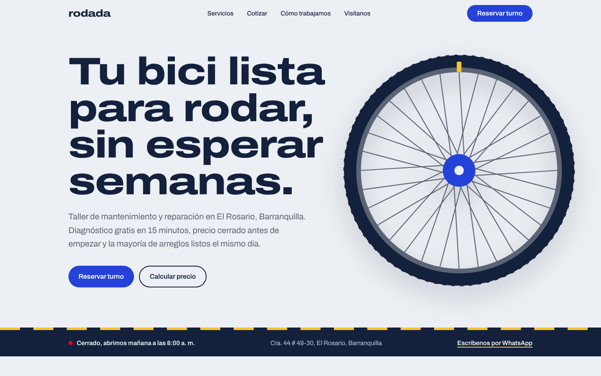
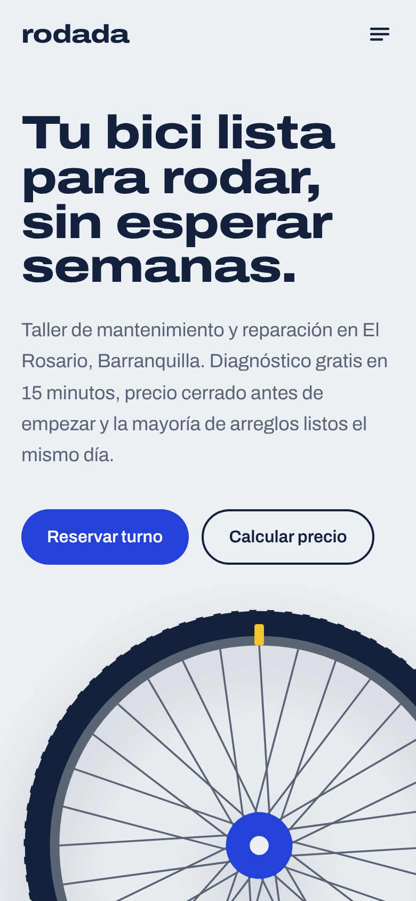

# Taller Rodada

Página de un taller de bicicletas en El Rosario, Barranquilla. La idea es que la persona sepa en segundos qué hace el taller, cuánto le va a costar el arreglo y pueda reservar un turno sin llamar.

En vivo: https://taller-rodada.vercel.app



## Lo que tiene

- Cotizador: eliges el tipo de bici y los servicios y muestra el precio, el tiempo de trabajo y el día de entrega. Lo cotizado pasa marcado a la reserva.
- Reserva de turno por la mañana o por la tarde (los domingos solo hay en la mañana). Se valida igual en el formulario y en el servidor con el mismo esquema de Zod, con protección contra bots y límite de envíos.
- Al reservar muestra el resumen, un botón para confirmar por WhatsApp y un archivo para agregar la cita al calendario.
- Avisa si el taller está abierto o cerrado según la hora de Colombia.
- Imagen para compartir el enlace generada con código, sitemap y datos para buscadores.

<p align="center"></p>

Los colores salen de la señalización vial para ciclistas: azul de las señales y amarillo de la demarcación. La rueda de arriba es un SVG que gira con el scroll.

## Con qué está hecha

Next.js con React y TypeScript, Tailwind CSS y Zod. La fuente es Archivo, usando su eje de ancho. Todos los datos del negocio (precios, servicios, horario, preguntas) están en `src/data/taller.ts`. Pruebas con Vitest para el cotizador, el horario y la reserva.

## Correrla

```bash
npm install
npm run dev
npm test
npm run build && npm start
```

Falta guardar las reservas: en `src/app/api/reservas/route.ts` está el punto donde conectar una base de datos o un servicio de correo.

El taller, la dirección y los datos de contacto son inventados.
